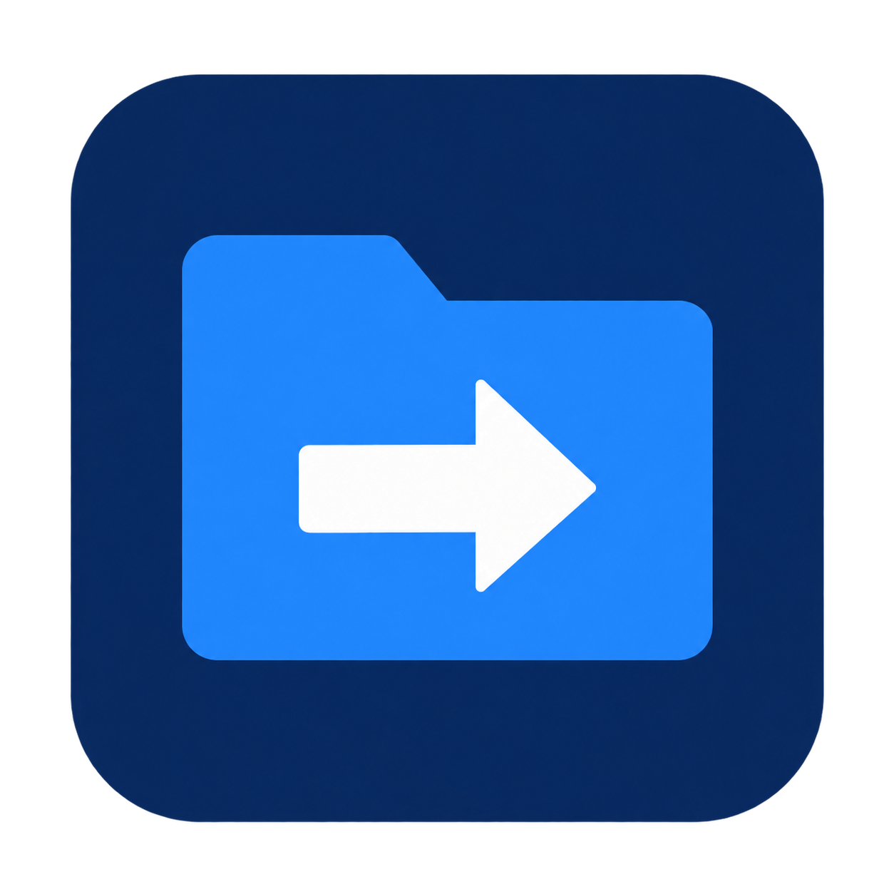

# SapienCopy



A portable Windows app for copying files and folders with Robocopy. Select what to copy, choose a destination, and follow the transfer from one window.

[Download the latest release](https://github.com/CAATZ/SapienCopy/releases/latest) · [User guide](README.txt) · [Release notes](RELEASE-NOTES.txt)

## Features

- Select individual files or folders, with folder exclusions and drag and drop.
- Copy directly into a destination, create a dated copy, or update an existing copy.
- Display transfer speed, activity, and optional percentage progress and estimated time remaining.
- Include all OneDrive files, copy downloaded files only, or exclude OneDrive.
- Pause and resume with source and destination volume checks, including changed drive letters.
- Copy to NTFS, exFAT, and FAT32, with compatibility and file-size checks.
- Save optional logs and reports, and optionally clear the selection lists after a successful copy.

## Quick start

1. Download and extract the portable ZIP, then run `SapienCopy-v1.10.0.exe`.
2. Add source files or folders and any excluded folders.
3. Select a destination, copy mode, and OneDrive policy.
4. Choose whether to calculate progress and ETA or save logs, then select **Start copy**.
5. Check the final result for skipped items, warnings, or errors.

Requires 64-bit Windows, .NET Framework 4.8, and the included Windows Robocopy command. Source and destination paths must use local drive letters. The Windows system volume must be NTFS for temporary working files. No installation is needed.

Unchanged files are skipped; differing files are replaced. Destination-only files are kept. The app does not delete source data or mirror deletions.

## Pause and resume

Pause stops the transfer's copy processes and keeps the job in memory. It does **not** eject a drive. To move a USB drive, wait for **Paused**, safely eject it through Windows, reconnect it, and select **Resume**. The original volumes and output folder are checked before writing.

Robocopy restartable copying is enabled, but an interrupted file can still restart from the beginning. Exact byte-offset recovery is not guaranteed. Keep the app open: resume state does not survive an app or Windows restart.

## Build and test

Clone or download the source, open Windows PowerShell in its folder, and run:

```powershell
.\build.ps1
.\test.ps1
```

The build uses the installed .NET Framework x64 C# compiler and needs no package restore. To include interface checks and test the built executable's worker:

```powershell
.\test.ps1 -Ui -ReleaseExe .\SapienCopy-v1.10.0.exe
```

Tests use isolated fixtures and keep their logs under `%LOCALAPPDATA%\SapienCopy\Tests`. Use `Get-Help .\test.ps1 -Full` for other options, including a custom output folder and the local interrupted-copy diagnostic.

## Limits

Progress and remaining time are estimates and may be unavailable after a sizing error. Downloaded-only OneDrive copying uses locally cached entries; it cannot count uncached cloud-only names or guarantee that later file access never involves OneDrive.

The app checks Robocopy results but does not hash every copied file or test restoration. Physical USB reconnection, drive-letter changes, physical exFAT/FAT32 copies, live OneDrive stalls, and elevated Explorer drag and drop have not been validated for this release. See the [user guide](README.txt) for details and safe-removal steps.

The executable is unsigned; release downloads include SHA-256 checksums. SapienCopy is an independent project and is not affiliated with Microsoft.
